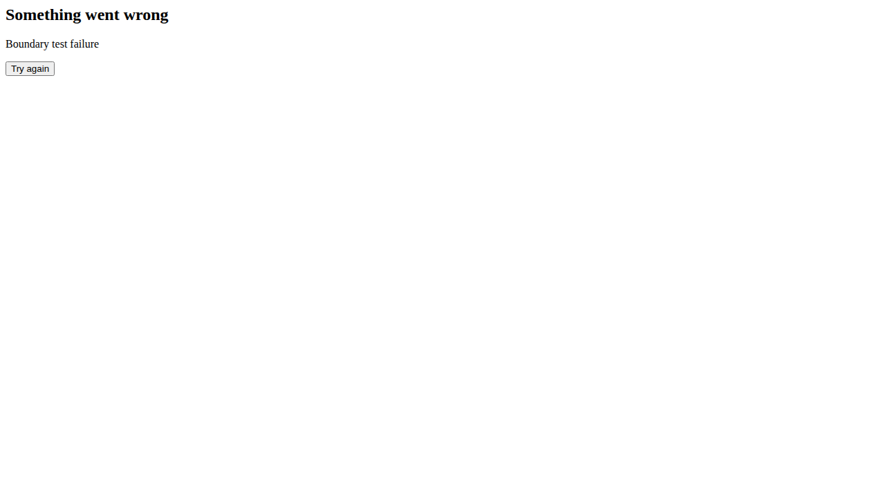

# SerpBear

[](https://app.codacy.com/gh/djav1985/v-serpbear/dashboard)   

SerpBear is a full-stack Next.js application that tracks where your pages rank on Google, adds Google Search Console and Google Ads data to those rankings, and sends scheduled email digests. It ships as a Docker image or a plain Node.js app, and offers a REST API and a read-only MCP server so scripts and AI assistants can read your rankings.

> **Warning:** Not every scraper provider is validated on every release. Report problems with a specific provider in [GitHub Discussions](https://github.com/djav1985/v-serpbear/discussions).




## Contents

- [Quick links](#quick-links)
- [Features](#features)
- [Getting started](#getting-started)
- [Supported SERP data providers](#supported-serp-data-providers)
- [Configuration reference](#configuration-reference)
- [Feature deep dive](#feature-deep-dive)
- [External API](#external-api)
- [MCP server](#mcp-server)
- [Development workflow](#development-workflow)
- [Continuous integration](#continuous-integration)
- [Project structure](#project-structure)
- [Contributing](#contributing)
- [Credits](#credits)
- [License](#license)

## Quick links

- 📘 **Documentation:** <https://docs.serpbear.com/>
- 📜 **Changelog:** [`CHANGELOG.md`](./CHANGELOG.md)
- 🐳 **Docker Hub image:** <https://hub.docker.com/r/vontainment/v-serpbear>
- 🛟 **Community support:** [GitHub Discussions](https://github.com/djav1985/v-serpbear/discussions)
- Made by [Vontainment](https://vontainment.com)

---

## Features

**What this fork adds over [upstream SerpBear](https://github.com/towfiqi/serpbear)**

- **Map pack tracking.** Flags keywords where your business is in Google's local top three. See [Business name and map pack detection](#business-name-and-map-pack-detection).
- **Scrape strategy.** Choose how many result pages (1–10) are fetched per keyword, globally or per domain. This works around Google dropping `num=100`. See [Scrape strategy](#scrape-strategy).
- **Per-domain scrapers.** Give each domain its own provider and API key, or use one global scraper.
- **Scrape transparency.** The keyword details panel shows how many results were scraped, and `Not in First N` when a keyword is not found.
- **Google redirect resolving.** Optional [Serper](https://serper.dev) lookup turns `google.com/goto` result links into real URLs.
- **White labelling.** Custom name and logo, applied without a rebuild. Environment changes need a restart.
- **MCP server.** Read-only access to rankings, Search Console and ideas for AI assistants.
- **Hardening and stability.** Current Node.js, encrypted stored keys, login and API-key throttling, layered retries, and keywords stuck in "updating" after a crash are reset on the next startup.

**Core capabilities**

| Capability | Details |
| --- | --- |
| **Unlimited domains and keywords** | Track as many keywords as you like across multiple sites, per country, city and device. |
| **Managed SERP providers** | Nine providers with built-in retries (see [Supported SERP data providers](#supported-serp-data-providers)). |
| **Failed scrape controls** | Retry all failed scrapes immediately, or clear the retry queue from Settings. |
| **Keyword research** | Search volumes and suggestions from a Google Ads account. |
| **Search Console enrichment** | Impressions, clicks and CTR next to your rankings. |
| **Email digests** | Branded summaries of winners, losers and visits, opening with a tracker summary (tracked keywords, average position, map pack count). |
| **Reliable domain stats** | Background jobs and keyword changes save domain averages and map pack totals. See [How the average position is calculated](#how-the-average-position-is-calculated). |
| **Progressive web app** | Install the dashboard on iOS or Android. |
| **API and MCP** | Manage and read data programmatically. |

**Architecture**

| Layer | Responsibility |
| --- | --- |
| **Frontend and API** | Next.js 16 serving React pages, JSON endpoints and the MCP server from one codebase. |
| **Database** | SQLite through a custom `better-sqlite3` dialect (`database/sqlite-dialect.js`), with Sequelize and Umzug for models and migrations. No other engine is supported. |
| **Background workers** | A Node cron runner schedules scrapes, retries, Search Console refreshes and digests from cron expressions and a timezone setting. |
| **Refresh queue** | Per-domain locking prevents two refreshes of one domain at once, with configurable concurrency across domains. |
| **Settings** | Scraper, SMTP and Google Ads credentials live in the Settings UI and are stored in `data/settings.json` (secrets encrypted with `SECRET`). |

---

## Getting started

### Option 1 – Docker Compose

```bash
git clone https://github.com/djav1985/v-serpbear.git
cd v-serpbear
cp .env.example .env
# edit .env: replace every placeholder, and set USER, PASSWORD, SECRET, APIKEY and NEXT_PUBLIC_APP_URL
docker compose up -d
```

The app is served at <http://localhost:3030> (compose maps host port 3030 to container port 3000). Sign in with `USER` and `PASSWORD`, add a domain, then open **Settings → Scraper** to choose a provider and enter its API key.

Compose stores data in a named volume (`data`) mounted at `/app/data`. The volume name is prefixed with the project name (for example `v-serpbear_data`); find it with `docker volume ls`. The volume holds the SQLite database, `settings.json`, Search Console exports (`SC_<domain>.json`), keyword ideas (`IDEAS_*.json`), `session.json`, `email-throttle.json`, `failed_queue.json` and any white-label logo.

To back up, stop the container so the SQLite files are not copied mid-write, copy the directory out, then start it again:

```bash
docker compose stop
docker cp serpbear:/app/data ./serpbear-data-backup
docker compose start
```

### Option 2 – Node.js

1. Install Node.js **24.22.1 or a later 24.x release** (pinned in [`.nvmrc`](./.nvmrc)). Node.js 20 and older are not supported because Node.js 20 is end-of-life.
2. Run `npm install` (or `npm ci`).
3. Copy `.env.example` to `.env.local` and replace every placeholder with a real value.
4. Run `npm run db:migrate` to apply pending migrations. The tables themselves are created on first start (see [Database and migrations](#database-and-migrations)).
5. Start with `npm run dev`, or `npm run build && npm run start` for production. The cron worker is a separate process: run `npm run cron`, or use `npm run start:all` to run both together.

### Database and migrations

- SQLite files live in `./data` for Node.js, or in the `/app/data` volume for Docker.
- On first start the app creates any missing tables with `db.sync()` (`database/init.ts`, called from `instrumentation.ts`). Migrations in `database/migrations` then apply schema and data changes to existing databases.
- Docker runs migrations from `entrypoint.sh` at every container start, before the web app and cron worker start.
- For Node.js, run `npm run db:migrate`, and `npm run db:revert` to undo the latest migration.
- Keyword history rows default to `{}`; the migrations backfill legacy `'[]'` values.

### Updating

Back up `data/` first. With Docker, run `docker compose pull && docker compose up -d` and migrations apply on start. With Node.js, pull, run `npm install`, `npm run db:migrate`, then rebuild. Read the *Upgrade notes* in the [changelog](./CHANGELOG.md) before upgrading.

---

## Supported SERP data providers

| Provider | Pricing snapshot* | Geo targeting | Map pack | Mobile | Authentication |
| --- | --- | --- | --- | --- | --- |
| Serply (`serply`) | Plans from $49/mo | Country only (13 markets) | Yes | Yes | Headers `X-Api-Key` and `X-Proxy-Location` |
| SerpApi (`serpapi`) | Free 250/mo, plans from $75/mo | City | Yes | Yes | Query `api_key` and header `X-API-Key` |
| SearchApi (`searchapi`) | Plans from $40/mo | City | Yes | Yes | Query `api_key` |
| ValueSerp (`valueserp`) | Pay-as-you-go, 10,000 for $25 | City | Yes | Yes | Query `api_key` |
| Serper (`serper`) | Credit-based, 50,000 for $50 | City | No | No (desktop results; see below) | Query `apiKey` |
| HasData (`hasdata`) | Free 1,000/mo, plans from $49/mo | City | Yes | Yes | Header `x-api-key` |
| CrazySERP (`crazyserp`) | Pay-as-you-go | City | Yes (`locations` block) | Yes | Header `Authorization: Bearer` |
| PrismCrawl (`prismcrawl`) | 100 free credits, packages from $5 (about $0.21 per 1,000, valid 90 days) | City | Yes | Yes | Header `x-api-key` (POST JSON) |
| DataForSEO (`dataforseo`) | Pay-as-you-go, $50 minimum top-up | City | Yes (`local_pack`) | Yes | HTTP Basic, `login:password` in the API key field |

\*Pricing is indicative. Check each vendor before buying. The request formats are implemented in [`scrapers/services`](./scrapers/services).

Each page request asks for 10 results. The [scrape strategy](#scrape-strategy) sets how many pages are fetched.

Serper has no mobile option. In a refresh, a mobile keyword that has a matching desktop keyword (same domain, keyword, country and location) in the same run is not scraped. It takes the desktop keyword's result, so no extra request is made. A mobile keyword with no matching desktop keyword is scraped with desktop results, and a warning is logged for it.

### Per-domain scraper overrides

A domain can use its own provider without changing the global default. Open **Domains**, click a domain, and switch to the **Scraper** tab. Pick a provider (or **System Scraper** to inherit the global one) and enter the API key. Stored keys are encrypted.

Provider choice also affects speed. A refresh uses the faster parallel path only when every keyword in the run uses SerpApi or SearchApi. One keyword on any other provider moves the whole run to the sequential path (see [Performance, integrations and logging](#performance-integrations-and-logging)).

### Business name and map pack detection

The optional **Business Name** field in the domain scraper tab turns on map pack detection. Matching uses the name only, never the link.

1. Each provider builds a list of local results from its response, in the order Google shows them.
2. If one of the first three titles matches your business name, the keyword counts as a map pack appearance.
3. Names match ignoring case, punctuation, repeated spaces and `&` versus `and`, so `Smith & Sons, Inc.` matches `smith and sons inc`. Accents still matter.

Only the first results page is checked. In the keyword details, **Local Search Results** shows your listing in green and every other business in yellow. Only a match among the first three local results is green. The matching organic result is highlighted green too. Local results saved before this flag existed show yellow until the keyword is refreshed.

**Example:** for `vontainment.com`, enter "Vontainment" if that is your Google Business Profile name.

---

## Configuration reference

Behaviour is controlled by environment variables and by settings stored in `data/settings.json`. `.env.example` lists the defaults. The app does not reject placeholder values from `.env.example`, so replace every placeholder before the first start.

**Env files.** Next.js reads `.env.local` for local development and Docker Compose reads `.env`. The standalone cron worker (`npm run cron`) loads `.env.local` first, then `.env`.

### Authentication and session

| Variable | Default | Required | Description |
| --- | --- | --- | --- |
| `USER` | — | Yes | Dashboard username. `.env.example` uses `admin`. |
| `USER_NAME` | — | No | Takes precedence over `USER` when set. |
| `PASSWORD` | — | Yes | Dashboard password. Replace the `change-me` placeholder. |
| `SECRET` | — | Yes | Signs the session JWT stored in the `token` cookie and encrypts stored keys. Login returns 500 when it is unset. Changing it signs everyone out and makes stored encrypted keys unreadable, so they must be re-entered. Use a unique value per deployment (`openssl rand -hex 32`). |
| `APIKEY` | — | Yes | Key for REST and MCP clients, and for the cron worker's scheduled calls. When unset, scheduled jobs are skipped with a warning and MCP returns 500. Use `openssl rand -hex 32`. |
| `SESSION_DURATION` | `24` | No | Session lifetime in hours. Empty, zero, negative or non-numeric values use 24. |
| `TRUST_PROXY` | `0` | No | Number of reverse proxies in front of the app. `true` means 1, values above 10 are capped at 10, and invalid values mean 0. Login lockouts, API-key lockouts and the keyword-search and volume rate limits then use the `X-Forwarded-For` entry that many hops from the right. Without it, behind a proxy, every client shares the proxy's address. It also controls whether `X-Forwarded-Proto`, `X-Forwarded-Protocol` and `X-Forwarded-Ssl` set the `Secure` cookie flag; without it only the socket's TLS state does. |

### Application runtime

| Variable | Default | Required | Description |
| --- | --- | --- | --- |
| `NEXT_PUBLIC_APP_URL` | `http://localhost:3000` | No | Public URL of the deployment, used for the Google Ads OAuth return origin, email links and logo, and as the cron worker's fallback origin. Set it for real deployments. |
| `APP_URL` | — | No | Server-side origin for the cron worker's own calls to the app. It takes precedence over `NEXT_PUBLIC_APP_URL` for those calls, which helps in Docker when the public URL is not reachable from inside the container. Google Ads uses it only when `NEXT_PUBLIC_APP_URL` is unset. Email links ignore it. |
| `NEXT_PUBLIC_SCREENSHOTS` | `true` | No | Keyword thumbnails via thum.io. `false` shows favicons. `SCREENSHOTS` takes precedence when both are set. |
| `NEXT_PUBLIC_WHITE_LABEL` | `false` | No | Enables white-label branding (name and logo). |
| `WHITE_LABEL_LOGO_FILE` | `branding-logo.png` | No | File name only, stored in `/app/data`. Accepted extensions are `png`, `jpg`, `jpeg`, `gif`, `svg` and `webp`. Used only when `NEXT_PUBLIC_WHITE_LABEL=true`, and served without login at `/api/branding/logo` (404 if the file is missing). Recommended size is 96×96 px. |
| `NEXT_PUBLIC_PLATFORM_NAME` | `SerpBear` | No | App and email name. Used only in white-label mode. |

Branding changes need two different actions. Logo file changes apply on the next request, so refresh the browser. Environment value changes need a restart (`docker compose up -d` for Compose, or restart the Node.js process). Neither needs a rebuild.

The Docker image sets `HOSTNAME=0.0.0.0`, and the entrypoint sets `TZ` from `CRON_TIMEZONE`. The health check reads `PORT` (default 3000).

### Google integrations

| Variable | Default | Required | Description |
| --- | --- | --- | --- |
| `SEARCH_CONSOLE_CLIENT_EMAIL` | — | No | Service account email with access to your Search Console properties. |
| `SEARCH_CONSOLE_PRIVATE_KEY` | — | No | Matching private key; keep newlines escaped in `.env` files. |

Search Console credentials are read in this order: the domain's own credentials (saved in the domain's settings), then the Settings page, then the two environment variables above. Google Ads credentials are configured only in Settings (stored encrypted); there are no Google Ads environment variables. Google Ads sign-in requires `NEXT_PUBLIC_APP_URL` or `APP_URL` to be set.

### Email notifications

SMTP settings (server, port, username, password, sender, display name and TLS server name) are set in the Notification settings modal or via the settings API, and are not read from environment variables. The port is required: a blank port returns `400` with `SMTP has not been setup properly!`. The sender defaults to `no-reply@serpbear.com`, and the display name to the platform name.

Recipients are set per domain, in the domain's settings. There is no global recipient address. The optional `smtp_tls_servername` is trimmed of whitespace and trailing dots before it reaches Nodemailer.

### Settings stored in `data/settings.json`

Manage these in the Settings UI or at `/api/settings`.

| Key | Values and default |
| --- | --- |
| `scraper_type` | Global provider: `none` (default) or a provider ID from the [providers table](#supported-serp-data-providers). |
| `scraping_api` | Global provider API key (encrypted). |
| `scrape_interval` | `daily` when blank, `other_day`, `weekly`, `monthly` or `never`. See [Cron scheduling](#cron-scheduling). |
| `scrape_strategy` | `basic` (default) or `custom`. See [Scrape strategy](#scrape-strategy). |
| `scrape_pagination_limit` | Pages fetched per keyword with `custom`, from 1 to 10. Default 5. |
| `scrape_retry` | `false` (default). Auto Retry for failed scrapes. Its retry controls appear only when it is on. |
| `scrape_delay` | Milliseconds between requests to one domain. The server caps it at 30,000 (30 s). |
| `notification_interval` | `never` (default), `daily`, `weekly` or `monthly`. |
| `notification_email_from`, `notification_email_from_name` | Sender address (default `no-reply@serpbear.com`) and display name (default the platform name). |
| `smtp_server`, `smtp_port`, `smtp_username`, `smtp_password`, `smtp_tls_servername` | SMTP connection. The port is required. |
| `search_console_client_email`, `search_console_private_key` | Search Console service account, used when the domain has none of its own. |
| `adwords_*` | Google Ads credentials for keyword ideas. |
| `keywordsColumns` | Columns shown in the keyword table. |

`GET /api/settings` is public. Without a session it returns only `scraper_type`, `available_scapers`, `search_console_integrated`, `version` and `timezone`. `PUT /api/settings` needs a login session, and an API key is not accepted. It merges the payload: keys left out keep their stored values, and a secret sent empty is cleared.

### Cron scheduling

| Variable | Default | Description |
| --- | --- | --- |
| `CRON_TIMEZONE` | `America/New_York` | IANA timezone for scheduled jobs, for "today" in results and emails, and for history date keys. An unknown name falls back to the default. Changing it later does not re-key existing history. |
| `CRON_MAIN_SCHEDULE` | `0 0 0 * * *` | Time of the daily scrape (`scrape_interval` = `daily`) and of the Search Console refresh. |
| `CRON_FAILED_SCHEDULE` | `0 0 */1 * * *` | Retry of failed scrapes. Also drives the `hourly` scrape option, which is not in the Settings UI. |
| `CRON_EMAIL_SCHEDULE` | `0 0 6 * * *` | Time of day for digests. Weekly digests run on Mondays and monthly digests on the 1st, both at this time. |

How the settings map onto the schedule:

- `scrape_interval`: `daily` uses `CRON_MAIN_SCHEDULE`. `other_day` runs at midnight on odd days of the month, `weekly` at midnight on Mondays, and `monthly` at midnight on the 1st. `never` turns scheduled scraping off.
- `notification_interval`: `daily`, `weekly` and `monthly` use `CRON_EMAIL_SCHEDULE` as described above. `never` turns digests off.
- Settings changes apply without a restart. The worker watches `data/settings.json` and re-checks it every 30 minutes. `CRON_*` variables are read at startup, so they need a restart.
- The worker calls the app with `APIKEY` as a Bearer token. Without `APIKEY`, each scheduled call is skipped with a warning.

Expressions are normalised at runtime (quotes and stray whitespace are stripped). An invalid expression is logged and its job is not scheduled.

### Performance, integrations and logging

| Variable | Default | Description |
| --- | --- | --- |
| `REFRESH_QUEUE_CONCURRENCY` | `3` | Refresh tasks running at once. A domain is never refreshed twice at once. |
| `PARALLEL_REFRESH_CONCURRENCY` | `10` | Keywords scraped at once on the parallel path, which runs only when every keyword in the run uses SerpApi or SearchApi. Positive integer. |
| `PARALLEL_SCRAPE_CONCURRENCY` | `3` | Keywords scraped at once per domain on the sequential path, which is used for every other provider. Positive integer. |
| `SERPER_API_KEY` | empty | Free [Serper](https://serper.dev) key. When set, organic `google.com/goto` links are resolved to real URLs through Serper's `/resolve` endpoint, for every provider. Each SERP page makes one batched request with a 60 s timeout and no retries. Failures are logged as warnings and the Google link is kept. Without a key, those links stay as they are. |
| `LOG_LEVEL` | `info` | `error`, `warn`, `info` or `debug`. `off`, `none`, `false` or `0` disables logging. Logs are JSON on stdout, so use `docker logs -f <container>`. |

---

## Feature deep dive

### Keyword tracking workflow

1. **Add a domain** with the host name to monitor.
2. **Add keywords** with the query, country, optional state and city, and device (desktop or mobile).
3. **Scrape.** The cron worker asks the app to refresh keywords. The app queries your provider and stores positions, using the [scrape strategy](#scrape-strategy).
4. **Analyse.** Charts and tables show history, average position and day-over-day change.
5. **Share.** Use the API or MCP server, or send email digests.

### Keyword details panel

Click a keyword row for the full SERP snapshot, the rank-history chart and the local results.

- **Local Search Results.** Your business in green, others in yellow (see [Business name](#business-name-and-map-pack-detection)).
- **Google Search Result.** Your result is highlighted green, matched by position value so non-contiguous result sets still work.
- **Not found.** The badge reads `Not in First N`, where N is the number of results actually scraped. It reads `No Results` when nothing was scraped.
- **Map pack badge.** A "MAP" badge under the country flag in the dashboard and details, and "MP" in email digests. The domains overview shows a Map Pack counter.

### Scrape strategy

Google's removal of `num=100` limits SERP APIs to 10 results per request. The strategy sets how many pages are fetched per keyword, trading API credits against depth.

| Strategy | Behaviour | Requests per keyword |
| --- | --- | --- |
| **Basic** (default) | Page 1 only (positions 1–10). | 1 |
| **Custom** | Pages 1 to N, where N is 1–10 (default 5). Fetching stops early once the domain is found, or when a page is empty or fails. | 1 to N |

- **Globally:** **Settings → Scraper → Scrape Strategy**. Choosing Custom shows a page-count selector.
- **Per domain:** the domain's **Scraper** tab, **Scrape Strategy Override**. Any value other than **Use Global Setting** enables the domain controls.
- **Storage:** only results from fetched pages are stored, and the details panel reports the scraped count.
- **Failed pages:** if a page request fails and the domain was not found on the pages that loaded, the keyword is reported as an error with the provider's message. It keeps its previous position and history, rather than being recorded as "not ranked".

### How the average position is calculated

A domain's average position (on the dashboard card and in the digest) is a whole number, rounded from the keyword positions below. It is recalculated and saved after every refresh that stores results, and whenever keywords are added or deleted. Changing the scrape strategy, page count or business name does not change it until the next refresh. Digest emails recalculate it from the keywords when they are sent.

Each keyword is counted as follows:

1. **Latest scrape failed:** left out.
2. **In the map pack top three with a known spot (1–3):** counts at the better (lower) of its spot and its organic position. An organic position of 0 is ignored, so the spot is used.
3. **Organic position above 0:** counts at that position.
4. **Position 0, ranked before** (any saved history value above 0), **and not in the map pack top three:** counts at 10 × the pages scraped. Basic is 10. Custom is 10 × the page count, taken from the domain's setting first, then the global one (default 5).
5. **Anything else** (a keyword that never ranked, or a map pack keyword at 0 with no known spot): left out.

The Keywords and Map Pack counts include every keyword, whether or not it is in the average.

**Example:** keywords at positions 4 and 0 (ranked before, Basic), plus a map pack keyword at spot 2 with organic position 0, give (4 + 10 + 2) / 3 = 5.33, shown as 5.

The dashboard trend arrows compare each stat with its previous saved value. That value is replaced only when the stat changes.

### Keyword CSV export

Use **Export as csv** in the domain header. The file is named `<domain>-keywords_serp.csv` and has these columns: `ID`, `Keyword`, `Map Pack`, `Position`, `URL`, `Country`, `Location`, `Device`, `Updated`, `Added`, `Tags`.

- **Map Pack:** `0` when the keyword is not in the map pack top three, `1`, `2` or `3` for its spot, and empty when it is in the top three but no spot is known (rows saved before local results were stored).
- **Position:** `-` when the keyword is unranked.
- Text cells that start with `=`, `+`, `-` or `@` get a leading apostrophe, so spreadsheet apps read them as text. A lone `-` is the placeholder and is not changed.

### Keyword research and Google Ads

- Connect a Google Ads account in Settings to get suggestions and historical volumes. Ideas are also available through the REST API.
- The seed type decides where suggestions come from: `auto` uses the domain as a Google Ads site seed, `custom` uses your keyword list, `tracking` uses the domain's tracked keywords, and `searchconsole` uses the top 100 Search Console queries by impressions over the last 30 days.
- Ideas already tracked are disabled only when they are tracked for every selected device. A partly tracked idea can still be added for the missing device.
- When no ideas match, the API responds `404` and the UI shows an error toast.
- Email selected ideas from the research table or a domain's ideas tab. The research view asks for a destination domain first, and domain pages use the domain's notification addresses. Idea emails have their own limit of 10 per domain per hour and do not use the digest throttle.

### Google Search Console insights

- Authenticate with a service account (see [Google integrations](#google-integrations)) to add impressions, clicks and CTR to each keyword.
- Cached data is refetched when a dashboard or API read finds it more than 24 hours old, and by the cron at `CRON_MAIN_SCHEDULE`. Search Console days follow Pacific Time (`America/Los_Angeles`) whatever `CRON_TIMEZONE` is.
- The Discover tab disables keywords that are already tracked, and "select all" skips them.
- Search Console is optional. Without credentials, the dashboard card is hidden and the Insight tab shows a message.

### Notifications and reporting

- Digests summarise gains and losses, top movers and, when available, Search Console traffic.
- Frequency comes from `notification_interval` and the send time from `CRON_EMAIL_SCHEDULE`. Set `notification_interval` to `never` to stop digests. Clearing the SMTP settings makes each scheduled send fail with `400`.
- Each domain gets at most one digest per hour and five per calendar day in `CRON_TIMEZONE` (`utils/emailThrottle.ts`).
- **Send Notifications Now** in the Notification modal sends a digest for every domain with scraping enabled. Domains without a notification address, or held back by the throttle, are reported as skipped.
- `/api/notify` answers `401` for authentication problems, `404` for an unknown domain, `400` when the SMTP host or port is missing, and `500` only when every eligible domain failed to send. Otherwise it answers `200` with `sent` and `skipped` counts.

### Loading states

The domains index shows a full-page loader on first load. Keyword, idea and insight tables show their own spinner, so the surrounding workspace stays visible while data refreshes.

---

## External API

Send the header `Authorization: Bearer <APIKEY>` (the `APIKEY` environment value). The same key is the only credential the [MCP server](#mcp-server) accepts. Routes not listed in the [endpoint table](#endpoints-available-with-the-api-key) need a logged-in session. Every `domain` field is a real domain name such as `example.com`, not a URL slug.

### Sign-in and sessions

`POST /api/login` with a JSON `username` and `password` sets an httpOnly `token` cookie that lasts `SESSION_DURATION` hours. `POST /api/logout` revokes every session, not only the current one. Sign-in is locked for 15 minutes after 5 wrong passwords for one user from one address, 20 wrong attempts from one address, or 100 wrong attempts against the username overall. A locked attempt returns `429` with `TOO_MANY_ATTEMPTS`.

### API key lockout

Only a header of the exact form `Authorization: Bearer <APIKEY>` is treated as an API key. A valid key on a route outside the endpoint table returns `401` with the message `This Route cannot be accessed with API.`

After 5 wrong Bearer keys from one address within 15 minutes, that address gets `429` with `Retry-After: 900` for 15 minutes, even with the right key. A request with a valid login cookie is never refused for this reason. A correct key clears the failure count for its address, which cannot happen while the address is locked. The count is kept in memory and resets on restart. The address is the socket address, or the `TRUST_PROXY` entry when that is set.

### Endpoints available with the API key

| Method | Endpoint | Fields | What it does |
| --- | --- | --- | --- |
| GET | `/api/keyword` | Query `id` (required) | One keyword with its stored data and position history. An unknown ID returns `200` with `keyword: null`. |
| GET | `/api/keywords` | Query `domain` (required) | All tracked keywords of a domain. An unknown domain returns `200` with an empty list. |
| GET | `/api/domains` | Query `withstats` (`true` adds keyword statistics) | All tracked domains. With `withstats=true`, `avgPosition` and `mapPackKeywords` are left out when they are 0 or not saved yet. |
| POST | `/api/refresh` | Body `ids` (array of keyword IDs), or query `id` (comma-separated IDs, or `all` with query `domain`) | Starts a position refresh for the chosen keywords. |
| POST | `/api/cron` | None | Starts the background refresh that the scheduled cron runs, for every domain with scraping enabled. Returns `400` when no scraper is set up. The response can include a `skipped` list. |
| POST | `/api/notify` | Query `domain` (optional) | Sends the digest for one domain, or for all domains when omitted. See [Notifications and reporting](#notifications-and-reporting). |
| GET | `/api/searchconsole` | Query `domain` (required) | Search Console data of a domain. Refetched when the stored copy is more than 24 hours old. |
| POST | `/api/searchconsole` | None | Refreshes Search Console data for all domains. |
| GET | `/api/insight` | Query `domain` (required) | Search Console insight: top pages, keywords, countries and stats. Same 24-hour rule. |
| GET | `/api/ideas` | Query `domain` (optional; omit for the research page) | Saved keyword ideas and favourites. |
| POST | `/api/ideas` | Body `seedType` (required: `auto`, `custom`, `tracking` or `searchconsole`), `domain` (required for `auto`), `keywords` (up to 1000 strings), `country` (two letters), `language` (Google Ads language ID), `seedSCKeywords`, `seedCurrentKeywords` | Fetches and saves new ideas from Google Ads. Seed types are explained in [Keyword research and Google Ads](#keyword-research-and-google-ads). |

Set the key once, then call the API. The examples use port 3000 (Node.js). Docker Compose serves the app on port 3030.

```bash
export APIKEY=your-api-key
curl -H "Authorization: Bearer $APIKEY" "http://localhost:3000/api/keywords?domain=example.com"
curl -H "Authorization: Bearer $APIKEY" "http://localhost:3000/api/insight?domain=my-site.com"
```

A malformed domain returns `400` on `/api/insight`, `/api/searchconsole` and `/api/ideas`. An unknown domain returns `404` on `/api/insight`, `/api/searchconsole` and `/api/notify`.

### Session-only routes

These routes need a logged-in session and do not accept the API key.

| Route | Purpose | Limit |
| --- | --- | --- |
| `POST`, `PUT`, `DELETE /api/domains` | Add, edit and delete domains | — |
| `POST`, `PUT`, `DELETE /api/keywords` | Add, edit and delete keywords. Adding or deleting keywords recalculates the domain stats. | — |
| `GET /api/domain` | One domain's settings | — |
| `GET /api/refresh?keyword=…&country=…` | Live search for one keyword | 20 per minute per address |
| `GET /api/refresh?status=retry&id=…` | Whether keywords are currently refreshing | — |
| `POST /api/volume` | Google Ads search volume for keyword IDs or a domain | 6 domain lookups per hour per address; `domain=all` 2 per hour |
| `PUT /api/clearfailed` | Clear the failed retry queue | — |
| `PUT /api/settings` | Save settings | — |
| `GET`, `POST /api/adwords` | Google Ads OAuth and credential check | — |
| `PUT /api/ideas` | Save ideas and favourites | — |
| `POST /api/ideas/email` | Email selected ideas | 10 per domain per hour |
| `POST /api/login`, `POST /api/logout`, `GET /api/auth-check` | Sign in, sign out and check the session | Lockouts as above |
| `GET /api/branding/config`, `GET /api/branding/logo` | Branding and logo (public) | — |

### Responses

Successful (2xx) responses return named keys such as `domains`, `keywords`, `keyword` or `settings`, or `data` for ideas, Search Console and insight. Every response includes an `X-Request-Id` header.

```jsonc
// GET /api/domains - 200 OK
{
  "domains": [ /* DomainType[] */ ]
}
```

Errors (4xx/5xx) use one envelope:

```json
{
  "error": {
    "code": "NOT_FOUND",
    "message": "Domain not found",
    "details": "optional extra context"
  },
  "requestId": "1748901234567-abc123xyz"
}
```

| Field | Type | Description |
| --- | --- | --- |
| `error.code` | `string` | One of the codes below |
| `error.message` | `string` | Human-readable description |
| `error.details` | `unknown` (optional) | Extra context, such as validation errors |
| `requestId` | `string` (optional) | Matches the `X-Request-Id` header |

| `error.code` | Status | Meaning |
| --- | --- | --- |
| `BAD_REQUEST` | 400 | Invalid or missing input |
| `UNAUTHORIZED` | 401 | No valid session or API key |
| `MISSING_CREDENTIALS` | 401 | Login sent without a username or password |
| `INVALID_CREDENTIALS` | 401 | Wrong username or password |
| `NOT_FOUND` | 404 | Unknown domain or ID |
| `METHOD_NOT_ALLOWED` | 405 | HTTP method not supported by the route |
| `CONFLICT` | 409 | Domain already tracked, or a delete while it is being refreshed |
| `TOO_MANY_ATTEMPTS` | 429 | Login or API-key lockout |
| `TOO_MANY_REQUESTS` | 429 | Rate limit (keyword search, volume, idea email) |
| `BAD_GATEWAY` | 502 | Google or a scraper failed upstream |
| `INTERNAL_SERVER_ERROR` | 500 | Server error. The details are logged, not returned. |

---

## MCP server

SerpBear serves a read-only [Model Context Protocol](https://modelcontextprotocol.io) server at `/api/mcp` (Streamable HTTP, stateless). Any MCP client that accepts a remote URL and a header can connect.

- **URL:** `https://<your-host>/api/mcp`. Use HTTPS (for example behind a reverse proxy), because the key is sent on every request.
- **Header:** `Authorization: Bearer <APIKEY>`. This is the only accepted credential: cookies and login sessions do not work here, and a wrong key counts towards the same lockout as the REST API.
- **Errors:** a missing or wrong key returns HTTP `401` with the error code `UNAUTHORIZED`, in the REST error envelope, not as a JSON-RPC error.
- **Methods:** `POST` only; others return 405.

| Tool | Returns |
| --- | --- |
| `get_keyword` | One keyword by `id`, with position history |
| `list_keywords` | All keywords of a `domain` |
| `list_domains` | All domains, optionally with `withstats` |
| `get_searchconsole` | Raw Search Console rows for a `domain` (3, 7 and 30 days) |
| `get_insight` | Top pages, keywords and countries for a `domain` |
| `get_keyword_ideas` | Saved ideas and favourites for a `domain`, or the research list when omitted |

The tools call the app's own `/api` routes over loopback (`127.0.0.1`) with the same key, so every REST check still applies. Most tools only read stored data. `get_searchconsole` and `get_insight` can fetch from Google Search Console and store the result when the stored copy is more than 24 hours old.

Tools that start scrapes, send email or spend Google Ads quota are not exposed; use the [External API](#external-api) for those.

---

## Development workflow

- **Node.js:** run `nvm use` to adopt the version in `.nvmrc`, then `npm install`.
- **Lint:** `npm run lint` runs ESLint. `npm run lint:css` runs Stylelint on `styles/*.css`; use `npx stylelint "**/*.{css,scss}"` for component styles. ESLint warns above 200 characters per line and function complexity above 60. Prefix unused arguments or errors with `_`.
- **Typecheck:** `npx tsc --noEmit`. There is no npm script for it.
- **Tests:** `npm test` runs Jest with the `@happy-dom/jest-environment` adapter. `npm run test:ci` runs `jest --ci`, and `npm run test:cv -- --runInBand` produces serialised coverage. Use the camelCase `mapPackTop3` field name in keyword objects and test data.
- **Database:** `npm run db:migrate` and `npm run db:revert`.
- **Repository setup:** `npm run setup:git` sets `main` as the default git branch.
- **Build and run:** `npm run build`, then `npm run start`. `npm run start:all` runs the web server and cron worker together.
- **UI patterns:** add icons through the `ICON_RENDERERS` map in `components/common/Icon.tsx`, and reuse the exported keyword filtering helpers for table views. `SelectField` respects its `minWidth` prop (default 180). Google Ads and Search Console settings show the latest `settingsError` above the form.

## Continuous integration

- **Docker image** (`.github/workflows/docker-image.yml`): runs only when started by hand (`workflow_dispatch`). It builds the image and pushes it to `vontainment/v-serpbear`, tagged `latest` for `main`, `dev` for the `dev` branch, and with the commit SHA.
- **PR lint and auto-fix** (`.github/workflows/pr-auto-fix.yml`): runs on pull requests from branches in this repository (fork pull requests are skipped). It runs ESLint and Stylelint with `--fix` and commits any changes to the PR branch.
- **Tests and typecheck are not run in CI.** Run `npm run lint`, `npm test` and `npx tsc --noEmit` locally before opening a pull request.

## Project structure

| Path | Contents |
| --- | --- |
| `pages/` | Next.js pages (`domains`, `domain`, `research`, `login`) and the JSON and MCP routes in `pages/api/` |
| `components/` | React components grouped by area: `common`, `domains`, `ideas`, `insight`, `keywords`, `settings` |
| `services/` | Client data hooks and API calls, such as `useFetchKeywords` |
| `hooks/` | Shared React hooks, such as `useAuth` and `useBranding` |
| `utils/` | Server and shared helpers: refresh pipeline, average position, email throttle, rate limits, Search Console, timezone |
| `scrapers/` | Scraper registry, and `scrapers/services/` with one file per provider |
| `database/` | Sequelize models, `migrations/`, `init.ts` (table sync) and the SQLite dialect |
| `email/` | HTML email template |
| `styles/`, `public/` | Global CSS, and static assets such as icons, the web app manifest and flag sprites |
| `scripts/` | Repository helper scripts (`setup:git`) |
| `__tests__/` | Jest tests |
| `cron.js` | Scheduled jobs worker |
| `instrumentation.ts` | Next.js startup hook that initialises the database |
| `entrypoint.sh` | Docker entrypoint: runs migrations, then starts the web app and cron worker |
| `data/` | Runtime files (SQLite, settings, Search Console exports, retry queue). Git-ignored except `.gitkeep`. |

---

## Contributing

1. Fork and clone the repository.
2. Make focused commits with descriptive messages.
3. Add or update tests for any behavioural change.
4. Run `npm run lint` and `npm test` before opening a pull request, and update `CHANGELOG.md`.

See [`AGENTS.md`](./AGENTS.md) for repository-wide guidelines.

## Credits

SerpBear was created by Amruth Pillai and is distributed under the MIT License (see [`LICENSE`](./LICENSE)). The upstream project is at <https://github.com/towfiqi/serpbear>. This fork is maintained at <https://github.com/djav1985/v-serpbear>.

## License

SerpBear is distributed under the [MIT License](./LICENSE). Commercial support and custom integrations are available; open a discussion if you need help deploying at scale.
