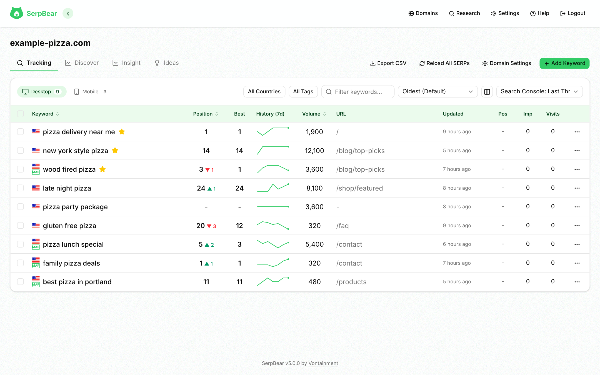

# SerpBear



[](https://app.codacy.com/gh/djav1985/v-serpbear/dashboard)   

SerpBear is a full-stack Next.js application that tracks where your pages rank on Google, adds Google Search Console and Google Ads data to those rankings, and sends scheduled email digests. It ships as a Docker image or a plain Node.js app, and offers a REST API and a read-only MCP server so scripts and AI assistants can read your rankings.

> **Warning:** Not every scraper provider is validated on every release. Report problems with a specific provider in [GitHub Discussions](https://github.com/djav1985/v-serpbear/discussions).

<br><br>

---

## Contents

- [What's new in 6.0.0](#whats-new-in-600)
- [Features](#features)
- [Getting started](#getting-started)
- [Supported SERP data providers](#supported-serp-data-providers)
- [Settings configured in `docker-compose.yml ENVs`](#settings-configured-in-docker-composeyml-envs)
- [Settings configured in `data/settings.json`](#settings-configured-in-datasettingsjson)
- [Feature deep dive](#feature-deep-dive)
- [API and MCP server](#api-and-mcp-server)
- [Project structure](#project-structure)
- [Credits](#credits)
- [License](#license)

<br><br>

---

## What's new in 6.0.0

- **SerpBase support and credit balances.** SerpBase joins the supported providers, and domain cards show remaining credits for providers that report them. Balances are stored per scraper and API key. See [supported SERP data providers](#supported-serp-data-providers) and [Credits remaining](https://github.com/djav1985/v-serpbear/wiki/Scrapers#credits-remaining).
- **Safer refreshes and keyword edits.** Refreshes, deletes, and location changes now coordinate per domain. Location changes clear the old ranking data before scraping again, and queued refreshes use the keywords' current state when they start.
- **Tighter request security.** Browser-triggered searches require a same-origin login session, request bodies have size limits, and requests from clients with unknown addresses no longer share a lockout bucket.
- **Smoother page changes.** Page transitions and panels now animate, with motion disabled for users who prefer reduced motion.
- **Updated runtime and dependencies.** The Docker image uses Node.js 26, and the project dependencies and tooling have been updated.

The full list of changes is in the [changelog](./CHANGELOG.md). See [Update SerpBear](#update-serpbear) before you upgrade.

<br><br>

---

## Features

**What this fork adds over [upstream SerpBear](https://github.com/towfiqi/serpbear)**

- **Map pack tracking.** Flags keywords where your business appears in Google's local top three, and shows map pack data in the tracker, domain stats, and digests. See [Business name and map pack detection](#business-name-and-map-pack-detection).
- **Per-domain scraper settings.** Choose a provider and API key for each domain, or inherit the global scraper. Set a scrape strategy per domain too. See [Per-domain scrapers](#per-domain-scrapers).
- **More scraper providers.** Adds PrismCrawl, DataForSEO and SerpBase to the seven providers shared with upstream. The fork removes the older SpaceSerp, ScrapingAnt, ScrapingRobot, and proxy integrations that upstream itself marks as no longer working.
- **Credits remaining.** Domain cards show the account balance for providers that report it, including DataForSEO's dollar balance. See [Credits remaining](https://github.com/djav1985/v-serpbear/wiki/Scrapers#credits-remaining).
- **Google redirect resolving.** Resolves `google.com/goto` result links through Serper's `/resolve` endpoint so SerpBear can match the actual destination domain.
- **Domain trend indicators and clearer averages.** Domain stats show movement since the previous refresh; average position has explicit handling for failed scrapes, keywords that drop out of results, and map pack positions. See [How the average position is calculated](#how-the-average-position-is-calculated).
- **Improved keyword workflows.** Discover and Ideas share an add-to-tracker bar with device, tags, and location controls. Existing keywords are skipped, and tracked keywords can be changed to a new location in bulk.
- **Idea emails and richer digests.** Email selected keyword ideas and see a tracker summary with average position and map pack counts in digest emails.
- **Flexible schedules.** Choose the time and timezone for scheduled scrapes, failed-scrape retries, Search Console refreshes, and email digests.
- **Read-only MCP server.** AI assistants can read rankings, Search Console data, and keyword ideas through MCP.
- **MCP OAuth flow.** Includes PKCE authorization, standard well-known discovery routes, a themed approval screen and token handling. OAuth approval uses the configured SerpBear username and password, or an existing login cookie. Cookie-based approval accepts only same-origin form submissions. `MCP_APIKEY` is for direct bearer access.
- **White-label branding.** Apply a custom app and email name and logo without rebuilding the app.
- **A rebuilt responsive interface.** The fork replaces the older pages with a responsive dashboard, shared data tables, settings panels, and transitions that respect reduced-motion preferences.

**Security and data integrity**

- Login and API-key lockouts, session expiry and revocation, same-origin checks for browser-triggered searches, bounded request bodies, and `TRUST_PROXY` support.
- Sensitive values are redacted from logs; MCP accepts API-key authentication rather than browser cookies.
- Destructive database migrations back up SQLite first. A unique index and duplicate merging prevent repeated tracking targets, and stale refresh flags are recovered.

**Performance and engineering**

- Parallel scraping for SerpApi and SearchApi, bounded concurrency for other providers, and per-domain refresh locks.
- Indexed keyword queries, virtualized large tables, single-pass statistics, and Search Console retrieval in pages of up to 25,000 rows.
- Next.js 16 App Router API and page routes share a typed codebase and common request handling. See [Project structure](#project-structure).

<br><br>

<br><br>

---

## Getting started

### Setup SerpBear

```bash
git clone https://github.com/djav1985/v-serpbear.git
cd v-serpbear
# edit docker-compose.yml: replace PASSWORD, SECRET, APIKEY and MCP_APIKEY, and set NEXT_PUBLIC_APP_URL
docker compose up -d
```

The checked-in Compose file sets these values directly under `environment:`, so edit that file before starting the container. `.env` values are not automatically passed through by this Compose configuration.

The image is published on [Docker Hub](https://hub.docker.com/r/vontainment/v-serpbear) as `vontainment/v-serpbear`: `latest` is the newest stable release, a version number such as `6.0.0` pins a release, and `beta` is the opt-in beta build.

The app is served at <http://localhost:3030> (compose maps host port 3030 to container port 3000). Sign in with `USER_NAME` (or `USER`) and `PASSWORD`, add a domain, then open **Settings → Scraper** to choose a provider and enter its API key.

<br><br>

### Update SerpBear

```bash
docker compose stop
docker cp serpbear:/app/data ./serpbear-data-backup
docker compose pull
docker compose up -d
```

This backs up the data directory, pulls the new image and recreates the container; migrations apply on start. With Node.js, pull the code, run `npm install`, `npm run db:migrate`, then rebuild. Read the *Upgrade notes* in the [changelog](./CHANGELOG.md) before upgrading.

<br><br>

### Supported SERP data providers

| Provider | Pricing snapshot* | Geo targeting | Map pack | Mobile | Credits left | Authentication |
| --- | --- | --- | --- | --- | --- | --- |
| Serply | Plans from $49/mo | Country | Yes | Yes | No | Header `X-Api-Key` |
| SerpApi | Free 250/mo, plans from $75/mo | City | Yes | Yes | Yes | Query `api_key` |
| SearchApi | Plans from $40/mo | City | Yes | Yes | Yes | Query `api_key` |
| ValueSerp | Pay-as-you-go, 10,000 for $25 | City | Yes | Yes | Yes | Query `api_key` |
| Serper | Credit-based, 50,000 for $50 | Country | No | No | No | Query `apiKey` |
| HasData | Free 1,000/mo, plans from $49/mo | City | Yes | Yes | Yes | Header `x-api-key` |
| CrazySERP | Pay-as-you-go | City | Yes | Yes | Yes | Header `Authorization: Bearer` |
| PrismCrawl | 100 free credits, packages from $5 (about $0.21 per 1,000, valid 90 days) | City | Yes | Yes | Yes | Header `x-api-key` (POST JSON) |
| DataForSEO | Pay-as-you-go, $50 minimum top-up | City | Yes | Yes | Yes (dollar balance) | HTTP Basic, `login:password` in the API key field |
| SerpBase | Credit-based | City | Yes | Yes | Yes | Header `X-API-Key` (POST JSON) |

> \*Pricing is indicative. Check each vendor before buying. The request formats are implemented in [`scrapers/services`](./scrapers/services).
The **Credits left** column shows which providers can report the balance left on your account. For those, the domain card shows `Credits remaining:` under the last-updated line, and it refreshes whenever keywords are refreshed. Serply and Serper have no lookup, so nothing is shown for them. DataForSEO shows a dollar balance. Details are in [Credits remaining](https://github.com/djav1985/v-serpbear/wiki/Scrapers#credits-remaining).

Each page request asks for 10 results. The [scrape strategy](#scrape-strategy) sets how many pages are fetched.

<br><br>

### Settings configured in `docker-compose.yml ENVs`

Behaviour is controlled by environment variables inside docker compose as well as in app settings.

| Variable | Default | Required | Description |
| --- | --- | --- | --- |
| `USER` | — | Yes | Dashboard username. `.env.example` uses `admin`. |
| `USER_NAME` | — | No | Takes precedence over `USER` when set. |
| `PASSWORD` | — | Yes | Dashboard password. Replace the `change-me` placeholder. |
| `SECRET` | — | Yes | Signs the session JWT stored in the `token` cookie and encrypts stored keys. Login returns 500 when it is unset. Changing it signs everyone out and makes stored encrypted keys unreadable, so they must be re-entered. Use a unique value per deployment (`openssl rand -hex 32`). |
| `APIKEY` | — | Yes | Key for REST clients and cron worker calls; MCP uses it internally for REST calls. Use `openssl rand -hex 32`. |
| `MCP_APIKEY` | — | For direct MCP access | Optional key for direct `Authorization: Bearer` access to `/api/mcp`. OAuth approval uses the configured SerpBear username and password, or an existing login cookie. Keep this key separate from `APIKEY`. |
| `MCP_ENABLED` | `true` | No | Master switch for MCP. Set to `false` to disable the MCP endpoint and OAuth protocol handlers. Also accepts `0`, `no` or `off`. |
| `MCP_OAUTH` | `false` | No | Set to `true` to enable OAuth registration, authorization, token and revocation handlers while MCP is enabled. Standard root and MCP-path-scoped discovery routes are served when `NEXT_PUBLIC_APP_URL` is configured. When false, direct MCP API-key access remains available. Also accepts `1`, `yes` or `on`. |
| `SESSION_DURATION` | `24` | No | Session lifetime in hours. Empty, zero, negative or non-numeric values use 24. |
| `TRUST_PROXY` | `0` | No | Number of reverse proxies in front of the app. `true` means 1, values above 10 are capped at 10, and invalid values mean 0. Login lockouts, API-key lockouts and the keyword-search and volume rate limits then use the `X-Forwarded-For` entry that many hops from the right. Without it, every client shares one address, so five wrong logins or API keys from anyone lock everyone out for 15 minutes. The app cannot see the connection's own address, and a client can send its own `X-Forwarded-For`, so the header is trusted only when you say how many proxies are in front. It also controls whether `X-Forwarded-Proto`, `X-Forwarded-Protocol` and `X-Forwarded-Ssl` set the `Secure` cookie flag; without it only the request's own `https://` URL does. |
| `NEXT_PUBLIC_APP_URL` | `http://localhost:3000` | No | Public app origin used for Google Ads OAuth redirects, MCP OAuth issuer/endpoint URL construction, email links and branding, and as the cron worker's fallback origin. Set it to the HTTPS origin in production; OAuth URLs must not include a path, query or fragment. |
| `APP_URL` | — | No | Server-side origin for the cron worker's own calls to the app. It takes precedence over `NEXT_PUBLIC_APP_URL` for those calls, which helps in Docker when the public URL is not reachable from inside the container. Google Ads and MCP OAuth use it only if `NEXT_PUBLIC_APP_URL` is unset. Email links ignore it. |
| `NEXT_PUBLIC_WHITE_LABEL` | `false` | No | Enables white-label branding (name and logo). The logo is always the file `logo.png` in `/app/data` (PNG, recommended size 96×96 px), served without login at `/api/images/logo.png`. The browser tab icon is the file `favicon.png` in the same folder, served at `/api/images/favicon.png`. When white-label is off or a file is missing, that URL serves the built-in default icon instead, so both always return an image. |
| `NEXT_PUBLIC_PLATFORM_NAME` | `SerpBear` | No | App and email name. Used only in white-label mode. |
| `SEARCH_CONSOLE_CLIENT_EMAIL` | — | No | Service account email with access to your Search Console properties. |
| `SEARCH_CONSOLE_PRIVATE_KEY` | — | No | Matching private key; keep newlines escaped in `.env` files. |
| `REFRESH_QUEUE_CONCURRENCY` | `3` | No | Refresh tasks running at once. A domain is never refreshed twice at once. |
| `PARALLEL_REFRESH_CONCURRENCY` | `10` | No | Keywords scraped at once on the parallel path, which runs only when every keyword in the run uses SerpApi or SearchApi. Positive integer. |
| `PARALLEL_SCRAPE_CONCURRENCY` | `3` | No | Keywords scraped at once per domain on the sequential path, which is used for every other provider. Positive integer. |
| `SERPER_API_KEY` | empty | No | Free [Serper](https://serper.dev) key. When set, organic `google.com/goto` links are resolved to real URLs through Serper's `/resolve` endpoint, for every provider. Each SERP page makes one batched request with a 30 s timeout. A failed or timed-out call is tried once more, and links still unresolved are sent once more after the `retryAfter` seconds Serper reports. Anything still unresolved keeps the Google link and is logged as a warning. Without a key, those links stay as they are. |
| `LOG_LEVEL` | `info` | No | `error`, `warn`, `info` or `debug`. `off`, `none`, `false` or `0` disables logging. Logs are JSON on stdout, so use `docker logs -f <container>`. |
| `CRON_TIMEZONE` | `America/New_York` | No | IANA timezone for scheduled jobs, "today" in results and emails, and history date keys. The entrypoint exports it as `TZ` for Node.js and child processes. An unknown name falls back to the default. Changing it later does not re-key existing history. |
| `CRON_MAIN_SCHEDULE` | `00:00` | No | Time of day (`HH:MM`, 24 hour) of every scheduled scrape and of the Search Console refresh. `scrape_interval` picks the days. |
| `CRON_FAILED_SCHEDULE` | `hourly` | No | How often failed scrapes are retried: `hourly`, `daily` (at the `CRON_MAIN_SCHEDULE` time) or `never`. |
| `CRON_EMAIL_SCHEDULE` | `06:00` | No | Time of day (`HH:MM`, 24 hour) of every email digest. `notification_interval` picks the days. |

<br><br>

### Settings configured in `data/settings.json`

Manage these in the Settings UI or at `/api/app/settings`.

| Key | Values and default |
| --- | --- |
| `scraper_type` | Global provider: `none` (default) or a provider ID from the [providers table](#supported-serp-data-providers). |
| `scraping_api` | Global provider API key (encrypted). |
| `scrape_interval` | `daily` when blank, `other_day`, `weekly`, `monthly` or `never`. See [Scheduling](#scheduling). |
| `scrape_strategy` | `basic` (default) or `custom`. See [Scrape strategy](#scrape-strategy). |
| `scrape_pagination_limit` | Pages fetched per keyword with `custom`, from 1 to 10. Default 5. |
| `scrape_retry` | `false` (default). Auto Retry for failed scrapes. Its retry controls appear only when it is on. |
| `scrape_delay` | Milliseconds between requests to one domain. The server caps it at 30,000 (30 s). |
| `notification_interval` | `never` (default), `daily`, `weekly` or `monthly`. |
| `notification_email_from`, `notification_email_from_name` | Sender address (default `no-reply@serpbear.com`) and display name (default the platform name). |
| `smtp_server`, `smtp_port`, `smtp_username`, `smtp_password`, `smtp_tls_servername` | SMTP connection. The port is required. |
| `search_console_client_email`, `search_console_private_key` | Search Console service account, used when the domain has none of its own. |
| `adwords_*` | Google Ads credentials for keyword ideas. |
| `keywordsColumns` | Columns shown in the keyword table. |

<br><br>

---

## Feature deep dive

### Keyword tracking workflow

1. **Add a domain** with the host name to monitor.
2. **Add keywords** with the query, country, optional state and city, and device (desktop or mobile).
3. **Scrape.** The cron worker (or **Refresh**) asks your provider for results and stores positions, using the [scrape strategy](#scrape-strategy).
4. **Analyse.** Charts and tables show history, average position and day-over-day change.
5. **Share** through the API, the MCP server or email digests.

### Scrape strategy

Google's removal of `num=100` limits SERP APIs to 10 results per request. The strategy sets how many pages are fetched per keyword, trading API credits against depth.

| Strategy | Behaviour | Requests per keyword |
| --- | --- | --- |
| **Basic** (default) | Page 1 only (positions 1–10). | 1 |
| **Custom** | Pages 1 to N, where N is 1–10 (default 5). Fetching stops early once the domain is found, or when a page is empty or fails. | 1 to N |

- **Globally:** **Settings → Scraper → Scrape Strategy**. Choosing Custom shows a page-count selector.
- **Per domain:** the domain's **Scraper** tab, **Scrape Strategy Override**. Any value other than **Use Global Setting** enables the domain controls.
- **Failed pages:** if a page request fails and the domain was not found on the pages that loaded, the keyword is reported as an error with the provider's message. It keeps its previous position and history rather than being recorded as "not ranked".

### Per-domain scrapers

A domain can use its own provider without changing the global default. Open the domain, switch to the **Scraper** tab, pick a provider (or **System Scraper** to inherit the global one) and enter its API key. Stored keys are encrypted.

A refresh uses the faster parallel path only when every keyword in the run uses SerpApi or SearchApi. See `PARALLEL_REFRESH_CONCURRENCY` and `PARALLEL_SCRAPE_CONCURRENCY` in the settings table above.

**Serper.** Serper has no mobile option. In a refresh, a mobile keyword with a matching desktop keyword (same domain, keyword, country and location) in the same run is not scraped. It takes the desktop keyword's result, so no extra request is made. A mobile keyword with no matching desktop keyword is scraped with desktop results, and a warning is logged for it.

### Scheduling

- `scrape_interval` runs at the `CRON_MAIN_SCHEDULE` time: `daily` every day, `other_day` on odd days of the month, `weekly` on Mondays, `monthly` on the 1st. `never` turns scheduled scraping off.
- `notification_interval` runs at the `CRON_EMAIL_SCHEDULE` time: `daily`, `weekly` (Mondays) or `monthly` (the 1st). `never` turns digests off.
- Failed scrapes are retried at the `CRON_FAILED_SCHEDULE` rate, and only while **Auto Retry** (`scrape_retry`) is on.
- Settings changes apply without a restart: the worker watches `data/settings.json` and re-checks it every 30 minutes. `CRON_*` variables are read at startup, so they need a restart.

### Business name and map pack detection

The optional **Business Name** field in the domain's scraper tab turns on map pack detection. Matching uses the name only, never the link.

1. Each provider builds a list of local results from its response, in the order Google shows them.
2. If one of the first three titles matches your business name, the keyword counts as a map pack appearance.
3. Names match ignoring case, accents, punctuation, repeated spaces and `&` versus `and`, so `Smith & Sons, Inc.` matches `smith and sons inc`.

**Example:** for `vontainment.com`, enter "Vontainment" if that is your Google Business Profile name.

Only the first results page is checked. The keyword details panel shows **Local Search Results** with your listing in green (a match among the first three) and other businesses in yellow, and highlights your organic result in green. Results saved before this flag existed show yellow until the keyword is refreshed.

### Keyword details panel

Click a keyword row for the SERP snapshot, the rank-history chart and the local results.

- **Not found.** The badge reads `Not in First N`, where N is the number of results actually scraped, or `No Results` when nothing was scraped.
- **Map pack.** A "MAP" badge sits under the country flag in the dashboard and details, and "MP" in email digests. The domains overview shows a Map Pack counter.

### How the average position is calculated

A domain's average position (on the dashboard card and in the digest) is a whole number, rounded from the keyword positions below. It is recalculated after every refresh that stores results and whenever keywords are added or deleted. Changing the scrape strategy, page count or business name does not change it until the next refresh.

Each keyword is counted as follows:

1. **Latest scrape failed:** left out.
2. **In the map pack top three with a known spot (1–3):** counts at the better (lower) of its spot and its organic position. An organic position of 0 is ignored, so the spot is used.
3. **Organic position above 0:** counts at that position.
4. **Position 0, ranked before** (any saved history value above 0), **and not in the map pack top three:** counts at 10 × the pages scraped. Basic is 10. Custom is 10 × the page count, taken from the domain's setting first, then the global one (default 5).
5. **Anything else** (never ranked, or a map pack keyword at 0 with no known spot): left out.

The Keywords and Map Pack counts include every keyword, whether or not it is in the average. The dashboard trend arrows compare each stat with its previous saved value.

**Example:** keywords at positions 4 and 0 (ranked before, Basic), plus a map pack keyword at spot 2 with organic position 0, give (4 + 10 + 2) / 3 = 5.33, shown as 5.

### Keyword CSV export

**Export as csv** in the domain header downloads `<domain>-keywords_serp.csv` with the columns `ID`, `Keyword`, `Map Pack`, `Position`, `URL`, `Country`, `Location`, `Device`, `Updated`, `Added` and `Tags`.

- **Map Pack:** `0` when not in the top three, `1`–`3` for its spot, and empty when it is in the top three but no spot is known.
- **Position:** `-` when the keyword is unranked.
- Text cells that start with `=`, `+`, `-` or `@` get a leading apostrophe so spreadsheet apps read them as text.

### Google Search Console

- Add a service account to show impressions, clicks and CTR next to each keyword. Credentials are read from the domain's own settings first, then the Settings panel, then `SEARCH_CONSOLE_CLIENT_EMAIL` and `SEARCH_CONSOLE_PRIVATE_KEY`.
- Cached data is refetched when a dashboard or API read finds it more than 24 hours old, and by the cron at the `CRON_MAIN_SCHEDULE` time. Search Console days follow Pacific Time (`America/Los_Angeles`) whatever `CRON_TIMEZONE` is.
- The Discover tab disables keywords that are already tracked, and "select all" skips them.
- It is optional. Without credentials the dashboard card is hidden and the Insight tab shows a message.

### Keyword research and Google Ads

- Connect a Google Ads account in Settings (there are no Google Ads environment variables) to get suggestions and historical volumes. Sign-in needs `NEXT_PUBLIC_APP_URL` or `APP_URL` to be set.
- The seed type decides where suggestions come from: `auto` uses the domain as a site seed, `custom` your keyword list, `tracking` the domain's tracked keywords, and `searchconsole` its top 100 Search Console queries by impressions over the last 30 days.
- An idea is disabled only when it is tracked for every selected device, so a partly tracked idea can still be added for the missing device.
- Selected ideas can be emailed from the research table or a domain's ideas tab, limited to 10 per domain per hour.

### Email digests

- Digests summarise gains and losses, top movers and, when available, Search Console traffic, opening with a tracker summary.
- SMTP (server, port, username, password, sender, display name and TLS server name) is set in the Notification settings modal, not in environment variables. The port is required. The sender defaults to `no-reply@serpbear.com`.
- Recipients are set per domain, in the domain's settings. There is no global recipient. Clearing the SMTP settings makes scheduled sends fail with `400`.
- Each domain gets at most one digest per hour and five per calendar day in `CRON_TIMEZONE`.
- **Send Notifications Now** in the Notification modal sends a digest for every domain with scraping enabled. Domains without a notification address, or held back by the throttle, are reported as skipped.

### White labelling

Set `NEXT_PUBLIC_WHITE_LABEL=true` for a custom name and logo. Logo and favicon file changes apply on the next request, so refresh the browser. Environment value changes need a restart (`docker compose up -d` or restarting the Node.js process). Neither needs a rebuild.

### Settings and data

Settings are stored in `data/settings.json`, with secrets encrypted using `SECRET`. `GET /api/app/settings` is public and returns only `scraper_type`, `available_scapers`, `search_console_integrated`, `version`, `timezone` and a read-only `branding` object (name and logo, used by the login and OAuth approval pages) without a session. `PUT /api/app/settings` needs a login session (an API key is not accepted). It merges the payload: keys left out keep their stored values, and a secret sent empty is cleared.

Docker Compose stores data in a named volume (`data`) mounted at `/app/data`, prefixed with the project name (for example `v-serpbear_data`; find it with `docker volume ls`). It holds the SQLite database, `settings.json`, Search Console exports (`SC_<domain>.json`), keyword ideas (`IDEAS_*.json`), `session.json`, `email-throttle.json`, `failed_queue.json` and any white-label logo.

<br><br>

---

## API and MCP server

The REST API uses `APIKEY`; MCP has a separate `MCP_APIKEY`. Domains are always real domain names such as `example.com`.

<br><br>

### MCP server

A read-only [Model Context Protocol](https://modelcontextprotocol.io) server for AI assistants, with direct-key and OAuth connection options.

- **URL:** `https://<your-host>/api/mcp` (Streamable HTTP, `POST` only). Use HTTPS, because the key is sent on every request.
- **Direct key:** header `Authorization: Bearer <MCP_APIKEY>`. Cookies and login sessions are not accepted.
- **OAuth:** set `MCP_OAUTH=true`; the approval page is `/api/oauth/approve`, while the authorization handler is `/api/oauth/authorize`. Approve with the configured `USER_NAME` (or `USER`) and `PASSWORD`, or use an existing valid login cookie. Cookie-based approval accepts only same-origin form submissions. Entering credentials approves this request without creating a login cookie. Read-only access can be selected. Incorrect credentials are limited to 10 attempts per detected IP per 15 minutes; when the IP is unknown, failed attempts share a fallback bucket, but correct credentials remain accepted after the limit is reached. OAuth client and token state is stored in `data/mcp_oauth.json`. When OAuth is enabled and `NEXT_PUBLIC_APP_URL` is configured, authorization-server metadata is served at `/.well-known/oauth-authorization-server` and `/.well-known/oauth-authorization-server/api/mcp`; protected-resource metadata is served at `/.well-known/oauth-protected-resource` and `/.well-known/oauth-protected-resource/api/mcp`. When `MCP_OAUTH` is unset or false, OAuth endpoints return 404 and the MCP challenge is `WWW-Authenticate: Bearer`. Set `MCP_ENABLED=false` to return 404 from direct MCP access and OAuth endpoints.

| Tool | Returns |
| --- | --- |
| `get_keyword` | One keyword by `id`, with position history |
| `list_keywords` | All keywords of a `domain` |
| `list_domains` | All domains, optionally with `withstats` |
| `get_searchconsole` | Raw Search Console rows for a `domain` (3, 7 and 30 days) |
| `get_insight` | Top pages, keywords and countries for a `domain` |
| `get_keyword_ideas` | Saved ideas and favourites for a `domain`, or the research list when omitted |

Tools that start scrapes, send email or spend Google Ads quota are not exposed; use the REST API for those.

<br><br>

### External API

A REST API for scripts and automation. Send `Authorization: Bearer <APIKEY>`. After 5 wrong keys from one address within 15 minutes, that address gets `429` for 15 minutes. Routes not listed below need a logged-in session.
Protected pages and API routes validate the login session directly; there is no separate session-check endpoint.

```bash
export APIKEY=your-api-key
curl -H "Authorization: Bearer $APIKEY" "http://localhost:3000/api/serp/keywords?domain=example.com"
```

The example uses port 3000 (Node.js). Docker Compose serves the app on port 3030.

| Method | Endpoint | What it does |
| --- | --- | --- |
| GET | `/api/serp/keyword?id=` | One keyword with its position history |
| GET | `/api/serp/keywords?domain=` | All tracked keywords of a domain |
| GET | `/api/serp/domains` | All tracked domains (`withstats=true` adds keyword statistics) |
| POST | `/api/serp/refresh` | JSON body `{ ids }` refreshes selected keywords; `{ scope: "domain", domain }` refreshes one domain; `{ scope: "enabled-domains" }` runs the scheduled refresh; `{ keyword, country, device }` runs a one-off keyword search (login session only, not an API key). Requests from a login session must come from this site |
| GET | `/api/serp/refresh?status=retry&id=…` | Read which keywords are still updating (read-only) |
| PUT | `/api/serp/keywords` | Update keywords: JSON body `ids` plus `sticky` (boolean), `tags` (ID-to-tag-list object), or `location` (string; include `country` if the location does not name one) |
| DELETE | `/api/serp/keywords` | Delete keywords: JSON body `ids` array |
| PUT | `/api/serp/domains` | Update a domain: JSON body `domain` plus any of `notification_emails`, `search_console`, `scrapeEnabled`, `scraper_settings`, `business_name`, `scrape_strategy`, or `scrape_pagination_limit` |
| DELETE | `/api/serp/domains` | Delete a domain: JSON body `domain` |
| PUT | `/api/app/settings` | Save app settings: JSON body `settings` object (login session required) |
| PUT | `/api/google/ideas` | Toggle an idea favorite: JSON body `keywordID`, optional `domain` |
| PUT | `/api/serp/clearfailed` | Clear the failed retry queue; no arguments |
| POST | `/api/app/email` | JSON body `{ type: "digest", domain? }` sends the digest for one domain or all; `{ type: "ideas", domain, keywords }` emails selected keyword ideas |
| GET | `/api/google/searchconsole?domain=` | Search Console data of a domain |
| POST | `/api/google/searchconsole` | Refresh Search Console data for all domains |
| GET | `/api/google/insight?domain=` | Search Console insight: top pages, keywords, countries and stats |
| GET | `/api/google/ideas` | Saved keyword ideas and favourites (`domain=` optional) |
| POST | `/api/google/ideas` | Fetch new ideas from Google Ads: body `seedType` (`auto`, `custom`, `tracking` or `searchconsole`), `domain`, `keywords`, `country`, `language` |

<br><br>

---

## Project structure

| Path | Contents |
| --- | --- |
| `app/` | The App Router front end. `(auth)/login`, and `(dashboard)/` with `domains`, `domain/[slug]` (Tracking), `domain/console`, `domain/insight`, `domain/ideas` and `research`. Each route keeps its own parts in a private `_components/` folder. |
| `app/api/` | JSON, MCP, OAuth protocol and OAuth approval-page routes (App Router route handlers/pages) |
| `components/ui/` | shadcn/ui building blocks (buttons, dialogs, selects, charts) |
| `hooks/`, `lib/` | Small shared helpers for the front end |
| `utils/` | Server and shared helpers: refresh pipeline, average position, email throttle, rate limits, Search Console, timezone |
| `scrapers/` | Scraper registry, and `scrapers/services/` with one file per provider |
| `database/` | Sequelize models, `migrations/`, `init.ts` (table sync) and the SQLite dialect |
| `email/` | HTML email template |
| `public/` | Static assets such as icons, the web app manifest and flag sprites. Global styles are in `app/globals.css` and `app/flags.css`. |
| `__tests__/` | Jest tests |
| `cron.js` | Scheduled jobs worker |
| `instrumentation.ts` | Next.js startup hook that initialises the database |
| `entrypoint.sh` | Docker entrypoint: runs migrations, then starts the web app and cron worker |
| `data/` | Runtime files (SQLite, settings, Search Console exports, retry queue). Git-ignored except `.gitkeep`. |

<br><br>

---

## Credits

SerpBear was created by Amruth Pillai. The upstream project is at <https://github.com/towfiqi/serpbear>. This fork is maintained at <https://github.com/djav1985/v-serpbear>. The dashboard UI is adapted from [next-shadcn-admin-dashboard](https://github.com/arhamkhnz/next-shadcn-admin-dashboard) by Mohammed Arham Khan.

## License

SerpBear is distributed under the [MIT License](./LICENSE). Commercial support and custom integrations are available; open a discussion if you need help deploying at scale.

The dashboard UI is adapted from [next-shadcn-admin-dashboard](https://github.com/arhamkhnz/next-shadcn-admin-dashboard) and is also distributed under the [MIT License](https://github.com/arhamkhnz/next-shadcn-admin-dashboard/blob/main/LICENSE).
