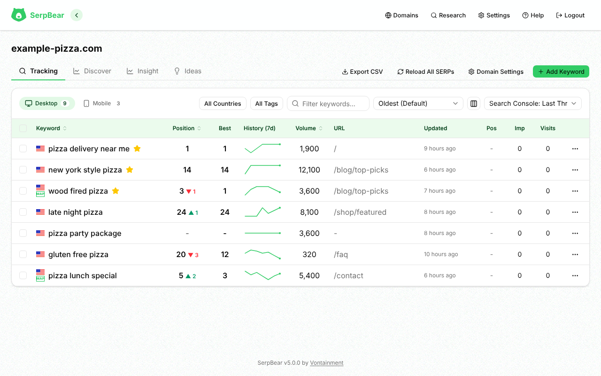
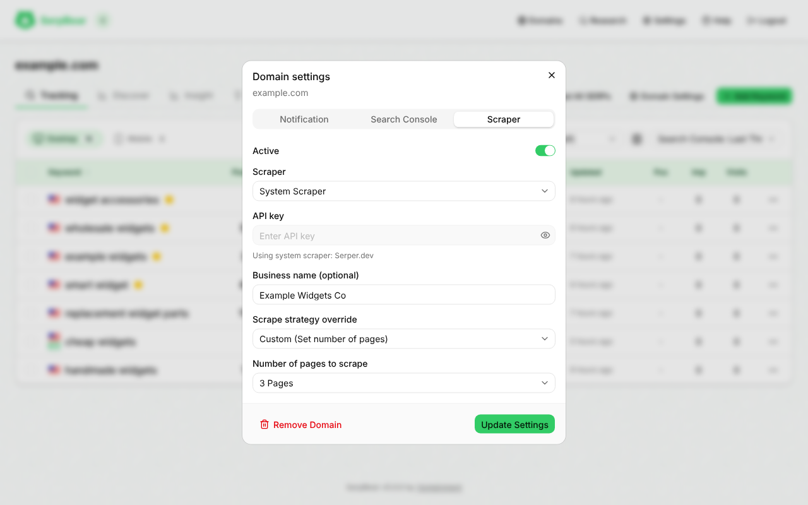

# Average Position and Map Pack

## How the average position is calculated

A domain's average position (on the dashboard card and in the digest) is a whole number, rounded from the keyword positions below. It is recalculated after every refresh that stores results and whenever keywords are added or deleted. Changing the scrape strategy, page count or business name does not change it until the next refresh.

Each keyword is counted as follows:

1. **Latest scrape failed:** left out.
2. **In the map pack top three with a known spot (1–3):** counts at the better (lower) of its spot and its organic position. An organic position of 0 is ignored, so the spot is used.
3. **Organic position above 0:** counts at that position.
4. **Position 0, ranked before** (any saved history value above 0), **and not in the map pack top three:** counts at 10 × the pages scraped. Basic is 10. Custom is 10 × the page count. A domain with its own strategy uses its own page count first, then the global one. A domain set to "Use Global Setting" uses the global strategy and page count only.
5. **Anything else** (never ranked, or a map pack keyword at 0 with no known spot): left out.

The Keywords and Map Pack counts include every keyword, whether or not it is in the average. The dashboard trend arrows compare each stat with its previous saved value.

**Example:** keywords at positions 4 and 0 (ranked before, Basic), plus a map pack keyword at spot 2 with organic position 0, give (4 + 10 + 2) / 3 = 5.33, shown as 5.

## Business name and map pack detection

The optional **Business name** field in **Domain Settings → Scraper** turns on map pack detection. Matching uses the name only, never the link.

1. Each provider builds a list of local results from its response, in the order Google shows them.
2. If one of the first three titles matches your business name, the keyword counts as a map pack appearance.
3. Names match ignoring case, accents, punctuation, repeated spaces and `&` versus `and`, so `Smith & Sons, Inc.` matches `smith and sons inc`.

**Example:** for `vontainment.com`, enter "Vontainment" if that is your Google Business Profile name.

Only the first results page is checked. The keyword details panel shows **Local Search Results** with your listing in green (a match among the first three) and other businesses in yellow, and highlights your organic result in green. Results saved before this flag existed show yellow until the keyword is refreshed.

Serper does not return map pack data. Check the map pack column in [Scrapers](Scrapers) before relying on it.
