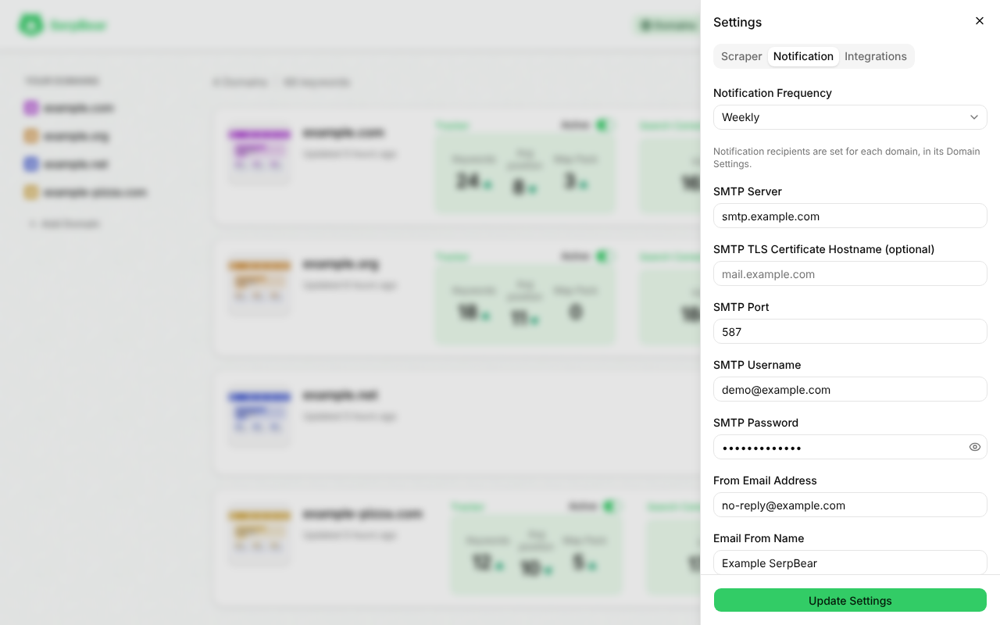
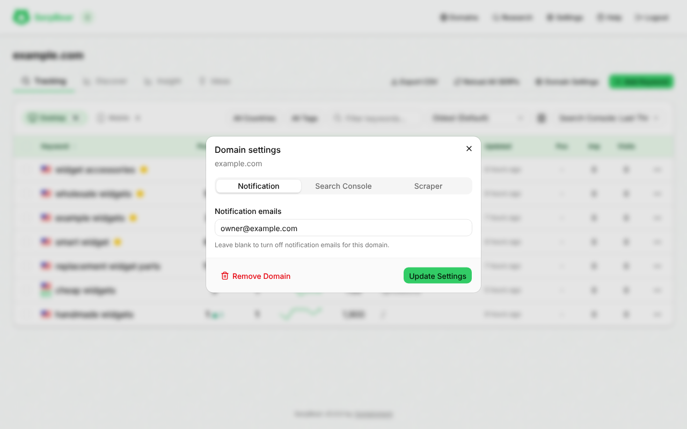

# Email Digests

- Digests summarise gains and losses, top movers and, when available, Search Console traffic, opening with a tracker summary (tracked keywords, average position, map pack count).
- **SMTP** (server, port, username, password, sender, display name and TLS server name) is set in **Settings → Notification**, not in environment variables. The port is required. The sender defaults to `no-reply@serpbear.com`.
- **Recipients** are set per domain, in **Domain Settings → Notification**. There is no global recipient. Clearing the SMTP settings makes scheduled sends fail with `400`.
- **When:** the `notification_interval` setting picks the days (`daily`, `weekly` on Mondays or `monthly` on the 1st), and `CRON_EMAIL_SCHEDULE` sets the time of day. See [Scheduling and Retries](Scheduling-and-Retries).
- **Limits:** each domain gets at most one digest per hour and five per calendar day in `CRON_TIMEZONE`.
- **Send Notifications Now** in **Settings → Notification** sends a digest for every domain with scraping enabled. Domains without a notification address, or held back by the throttle, are reported as skipped.
- Selected keyword ideas can also be emailed from the research table or a domain's ideas tab, limited to 10 per domain per hour.

