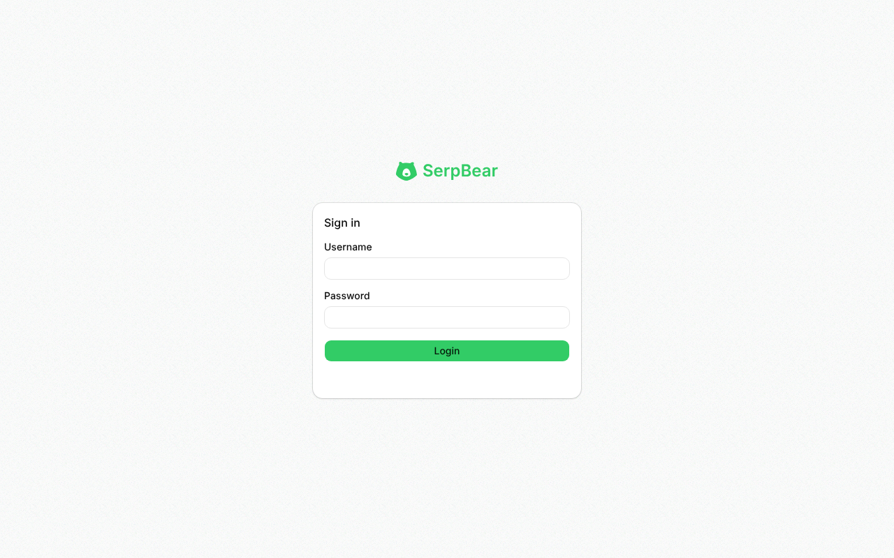
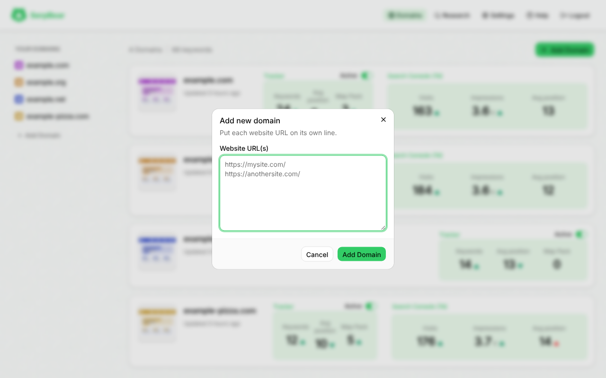
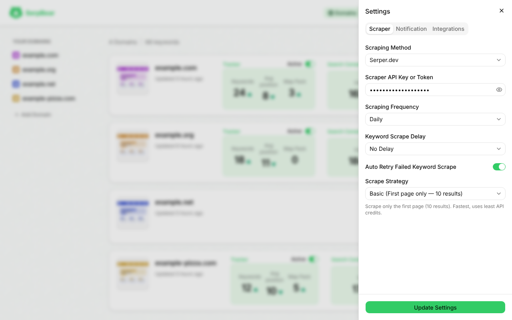
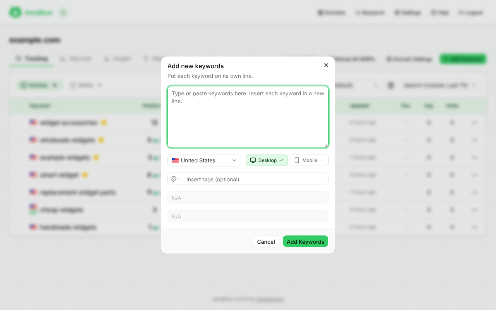
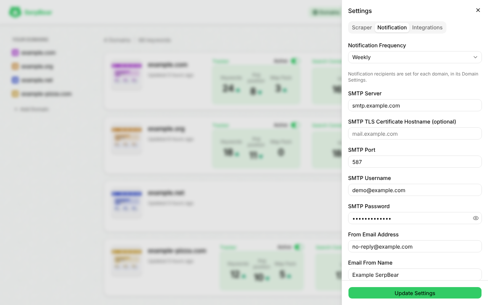

# Getting Started

SerpBear checks where your domains rank on Google. Google blocks direct scraping, so SerpBear asks a third-party SERP data provider (such as SerpApi, Serper.dev or ValueSerp) for the results and checks whether your domain appears for each keyword.

## Requirements

- **Required:** an account with one of the [supported SERP providers](Scrapers) and its API key. Several have free tiers.
- **Required:** somewhere to run it: your computer, or a server. The app needs to keep running, because the scheduled scrapes run inside it.
- **Optional:** an SMTP account, to receive position digests by email ([Email Digests](Email-Digests)).
- **Optional:** a free [Serper.dev](https://serper.dev) key for real result links (see below), and Google Search Console and Google Ads ([Google Integrations](Google-Integrations)).

## Step 1: Deploy and run the app

Choose how to run it. Each guide has its own page:

- [Deploy with Docker](Deploy-with-Docker): the simplest option, on your computer or a server. The image is on [Docker Hub](https://hub.docker.com/r/vontainment/v-serpbear).
- [Deploy with Node.js](Deploy-with-Node.js): without Docker.
- [Reverse Proxy and SSL](Reverse-Proxy-and-SSL): serve it on your own domain with HTTPS (Nginx or Traefik).
- [Deploy to Coolify](Deploy-to-Coolify)
- [Deploy to Fly.io](Deploy-to-Fly.io)

Whichever you choose, set `USER_NAME`, `PASSWORD`, `SECRET` and `APIKEY`, set `NEXT_PUBLIC_APP_URL` to the address you will open, and keep `/app/data` on persistent storage. Set a separate `MCP_APIKEY` only if you want direct MCP bearer access; OAuth uses your normal SerpBear login. Every variable is described in [Configuration](Configuration).

If you run it only on your computer, you won't be able to reach it from your phone or use the API from other tools.

## Step 2: Open the app and sign in



Open the app's address: <http://localhost:3030> with the Docker compose file, <http://localhost:3000> with Node.js, or the `NEXT_PUBLIC_APP_URL` value on a server. Sign in with the `USER_NAME` and `PASSWORD` you set.

## Step 3: Add your first domain



After signing in you land on the Domains page. With no domains yet it says "No domains found. Add a domain to get started!". Click **Add Domain** and enter a host name, such as `example.com`. You can add several at once, one per line.

## Step 4: Set up the scraper



Open **Settings → Scraper**, choose a provider, paste its API key and save, then refresh the page. See [Scrapers](Scrapers) for the providers, what each costs and which features they support. You can also give a single domain its own provider.

## Step 5: Add your first keywords



On a domain's Tracking tab, click **Add Keyword**, enter the keywords, choose the country and device (and a city, if your provider supports it), and add them. SerpBear fetches the results straight away and fills in the positions. See [Keyword Tracking](Keyword-Tracking).

## Step 6: Get email digests (optional)



Open **Settings → Notification** and enter your SMTP details, then set the domain's notification email in its **Domain Settings → Notification** tab. See [Email Digests](Email-Digests).

---

## Optional: Google Search Console and Google Ads

SerpBear works without these. Add them for real impressions, clicks and CTR next to your rankings, and for keyword research and search volumes. The steps are in [Google Integrations](Google-Integrations).

## Optional: free Serper.dev key for real result links

Some SERP providers return result links that are Google redirects, such as `https://www.google.com/goto?url=CAES...`, instead of the page's real address. SerpBear can't match your domain against a redirect link, so a keyword can look unranked or show the wrong URL.

[Serper.dev](https://serper.dev) has a `/resolve` endpoint that turns these redirect links into the real URLs, and **using it is free**. You only need to sign up for a free account to get an API key. No payment is required, and you don't have to use Serper as your scraper.

1. Sign up at [serper.dev](https://serper.dev) and copy your API key from the dashboard.
2. Set it as `SERPER_API_KEY` in your compose file or environment, for example `SERPER_API_KEY: your-serper-api-key`.
3. Restart SerpBear (`docker compose up -d`).

**How it works:**
- After a provider returns a page of results, SerpBear collects the links that are `google.com/goto` (or `/url`) redirects. Links that are already real URLs are left alone and never sent.
- All the redirect links from that page go to Serper's `/resolve` endpoint in one request. Serper follows each one and returns the real address, and SerpBear swaps it in before the position is saved.
- It works for every provider, not only Serper.
- A call can take up to about 30 seconds, so each request has a 30 second timeout. A call that fails or times out is tried once more. Links that come back unresolved are sent once more, after the number of seconds Serper asks for (`retryAfter`).
- Anything still unresolved keeps the Google link and a warning is logged. Without a key, redirect links stay as they are.

---

## Updating and your data

Back up the data before updating:

```bash
docker compose stop
docker cp serpbear:/app/data ./serpbear-data-backup
docker compose pull
docker compose up -d
```

Each deployment page has its own update steps. Migrations run automatically on start, and the database is backed up before any migration that changes data.

Docker Compose stores data in a named volume (`data`) mounted at `/app/data`, prefixed with the project name (for example `v-serpbear_data`; find it with `docker volume ls`). It holds the SQLite database, `settings.json`, Search Console exports (`SC_<domain>.json`), keyword ideas (`IDEAS_*.json`), `session.json`, `email-throttle.json`, `failed_queue.json` and any white-label `logo.png` and `favicon.png`. Secrets in `settings.json` are encrypted with `SECRET`.
