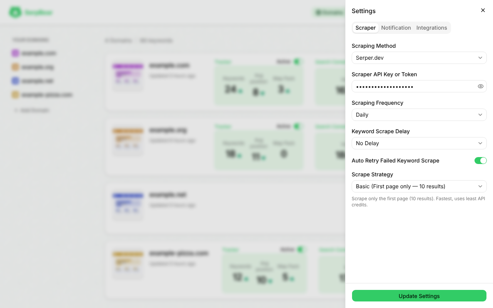
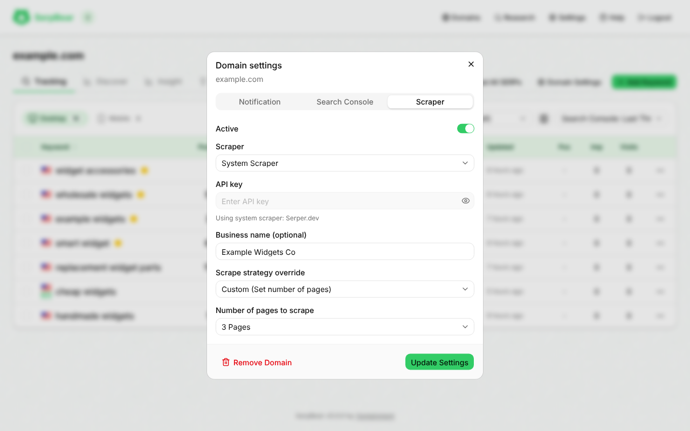

# Scrapers

SerpBear asks a SERP data provider for Google results. Pick one globally in **Settings → Scraper**, or give each domain its own.

## Supported providers



| Provider | Pricing snapshot* | Geo targeting | Map pack | Mobile | Credits left | Authentication |
| --- | --- | --- | --- | --- | --- | --- |
| Serply (`serply`) | Plans from $49/mo | Country | Yes | Yes | No | Header `X-Api-Key` |
| SerpApi (`serpapi`) | Free 250/mo, plans from $75/mo | City | Yes | Yes | Yes | Query `api_key` |
| SearchApi (`searchapi`) | Plans from $40/mo | City | Yes | Yes | Yes | Query `api_key` |
| ValueSerp (`valueserp`) | Pay-as-you-go, 10,000 for $25 | City | Yes | Yes | Yes | Query `api_key` |
| Serper (`serper`) | Credit-based, 50,000 for $50 | Country | No | No | No | Query `apiKey` |
| HasData (`hasdata`) | Free 1,000/mo, plans from $49/mo | City | Yes | Yes | Yes | Header `x-api-key` |
| CrazySERP (`crazyserp`) | Pay-as-you-go | City | Yes | Yes | Yes | Header `Authorization: Bearer` |
| PrismCrawl (`prismcrawl`) | 100 free credits, packages from $5 (about $0.21 per 1,000, valid 90 days) | City | Yes | Yes | Yes | Header `x-api-key` (POST JSON) |
| DataForSEO (`dataforseo`) | Pay-as-you-go, $50 minimum top-up | City | Yes | Yes | Yes (dollar balance) | HTTP Basic, `login:password` in the API key field |
| SerpBase | Credit-based | City | Yes | Yes | Yes | Header `X-API-Key` (POST JSON) |

\*Pricing is indicative. Check each vendor before buying. The request formats are implemented in [`scrapers/services`](https://github.com/djav1985/v-serpbear/tree/main/scrapers/services).

Each page request asks for 10 results. The scrape strategy below sets how many pages are fetched. For country-only providers (Serper, Serply) the city and state fields are disabled and show `N/A`.

## Credits remaining

Most providers will tell SerpBear how many credits are left on your account. When yours does, the domain card on the Domains page shows it right under the last-updated line:

```
Updated 2 hours ago
Credits remaining: 973,581
```

It saves you a trip to the provider's dashboard, and it's a quick way to catch an account that's about to run dry before the scrapes start failing.

### Which providers support it

| Provider | Shown | How SerpBear gets the number |
| --- | --- | --- |
| SerpApi | Yes | `GET /account.json` (`total_searches_left`, extra credits included). The call is free |
| SearchApi | Yes | `GET /api/v1/me` (`account.remaining_credits`) |
| ValueSerp | Yes | `GET /account`. Monthly credits plus top-up credits, added together |
| HasData | Yes | `GET /user/me/usage` (`data.availableCredits`) |
| CrazySERP | Yes | `GET /api/get-credits` (`available_credits.total`) |
| DataForSEO | Yes, in dollars | `GET /v3/appendix/user_data` (`money.balance`). DataForSEO bills by balance, so the card shows `$42.17` and not a credit count |
| SerpBase | Yes | `GET /account/credits` (`credits`, the total across permanent and expiring credits). The call is free |
| PrismCrawl | Yes | The `X-Credits-Remaining` header on every scrape response. There's no account endpoint to ask |
| Serper | No | No lookup available |
| Serply | No | No lookup available |

If the domain's scraper isn't on that list, the card shows nothing. That's on purpose: a blank is better than a made-up number.

### When the number updates

It updates when keywords are refreshed, scheduled or manual, and not when you open the page.
- **Account-endpoint providers** are asked once per API key at the end of the refresh run. Refresh 500 keywords on one key and that's one extra call, not 500.
- **PrismCrawl** sends the balance with every scrape. SerpBear keeps the lowest value it sees during the run and saves it when the run finishes.
- A domain shows nothing until its first refresh after you set up the scraper (or after you change the key), because there's no number to show yet.
- If the account call fails (a timeout, a bad key, the provider is down), SerpBear keeps the last saved number and the refresh carries on as normal.

### Domains that share a key

Credits belong to the provider account, not the domain. SerpBear saves one balance per scraper and API key, so every domain on the same key shows the same number. That covers domains on the global scraper, and domains with their own scraper that happen to use the same key. Domains with different keys each show their own balance. See [Per-domain scrapers](#per-domain-scrapers).

### Where it's stored

Balances live in `data/scraper_credits.json`, next to your other data files. Each entry holds the scraper, the remaining amount and the time it was recorded. The API key itself is never written there. Entries are keyed by a hash made with your `SECRET`, so the file doesn't give anyone a way back to your key.

Every save also cleans up. Any entry that no domain and not the global scraper uses anymore (an old key, a removed domain) is dropped. You never need to edit the file by hand. Deleting it is safe too: the numbers come back after the next refresh.

### If the line isn't showing

1. Check that the scraper is on the supported list above.
2. Run a refresh on the domain (or wait for the next scheduled one). The first number appears after that.
3. Make sure the API key is the one you're actually scraping with. A wrong key can't report a balance.
4. Turn on debug logging and look for `[CREDITS]` lines. They say when an account call failed and why.

## Scrape strategy

Google's removal of `num=100` limits SERP APIs to 10 results per request. The strategy sets how many pages are fetched per keyword, trading API credits against depth.

| Strategy | Behaviour | Requests per keyword |
| --- | --- | --- |
| **Basic** (default) | Page 1 only (positions 1–10). | 1 |
| **Custom** | Pages 1 to N, where N is 1–10 (default 5). Fetching stops early once the domain is found, or when a page is empty or fails. | 1 to N |

- **Globally:** **Settings → Scraper → Scrape Strategy**. Choosing Custom shows a page-count selector.
- **Per domain:** the domain's **Scraper** tab, **Scrape Strategy Override**. Any value other than **Use Global Setting** enables the domain controls.
- **Failed pages:** if a page request fails and the domain was not found on the pages that loaded, the keyword is reported as an error with the provider's message. It keeps its previous position and history rather than being recorded as "not ranked".

## Per-domain scrapers



A domain can use its own provider without changing the global default. Open the domain, switch to the **Scraper** tab, pick a provider (or **System Scraper** to inherit the global one) and enter its API key. Stored keys are encrypted. **Remove stored key** clears a domain's key on save.

A refresh uses the faster parallel path only when every keyword in the run uses SerpApi or SearchApi. See `PARALLEL_REFRESH_CONCURRENCY` and `PARALLEL_SCRAPE_CONCURRENCY` in [Configuration](Configuration).

**Serper.** Serper has no mobile option. In a refresh, a mobile keyword with a matching desktop keyword (same domain, keyword, country and location) in the same run is not scraped. It takes the desktop keyword's result, so no extra request is made. A mobile keyword with no matching desktop keyword is scraped with desktop results, and a warning is logged for it.

## Real links for Google redirects

Some providers return `google.com/goto` links instead of the real page address, so your domain would not match. Set `SERPER_API_KEY` (a free [Serper](https://serper.dev) key) and these links are resolved through Serper's `/resolve` endpoint, for every provider. Details are in [Configuration](Configuration).
